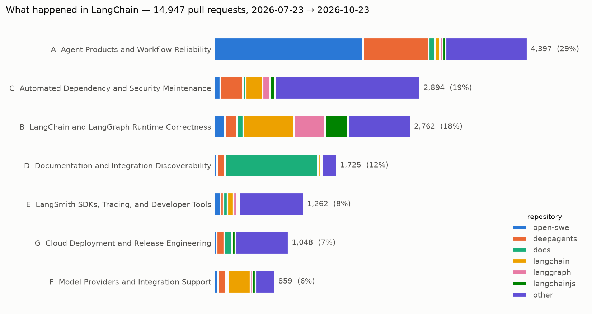

# What three months of LangChain pull requests say — findings from the SECNA run

> Workline `secna_notebook`, Step 4 (run review), second corpus. Written 2026-10-25 from the run of
> `notebook/test_secna_langchain.py`. **Kept as a working note — not integrated into the talk or the
> storyboard yet.** Public data only (GitHub public API); no contributor name or handle is quoted.
> Companion of [`0404_01_gitlab_findings.md`](0404_01_gitlab_findings.md).

**Question it answers**: the same recipe, the same code, another organisation — what does it show
about LangChain, and what would we not see otherwise?

> **Corrected 2026-10-25** (signal 2): first written as *631 PRs, 0 % and 13 % merged — agents propose a lot,
> people keep little*. Re-checked on the raw GitHub data and LangChain's public docs: 652 PRs, drafts by design,
> one account is a development instance. The reading changed; see signal 2.

---

## 1. The corpus

- **Source**: every pull request (PR) **created between 2026-07-23 and 2026-10-23** in the whole
  `langchain-ai` organisation on GitHub — **137 repositories**.
- **Size**: **14,947 PRs**, 1,607 authors. The biggest repositories: `open-swe` (2,574 PRs — the
  company's own coding agent), `deepagents`, `docs`, `langchain`, `langchainjs`, `langgraph`.
- **Who opens them** (rule of §6): people 10,132 · bots 4,235 (28 %) · signed by an agent 580.
- No labels to speak of on GitHub (unlike GitLab's `type::` / `devops::`): the clusters are the only
  structure.

## 2. How the run was made

Same notebook as GitLab — `test_secna_langchain.py` reuses every cell of `test_secna.py` with another
configuration; the extraction detects GitHub and turns each PR into the same shape as a GitLab merge
request.

| Step | What | Choice | Cost |
|---|---|---|---|
| Extract | GitHub GraphQL search, one day at a time (a search returns at most 1,000 results) | collection reused from the first fetch, no new call | free |
| **S** | one markdown text per PR: title · repository · origin · labels · description | no LLM; median 291 tokens | free |
| **E** | **LaBSE, locally on the CPU** (sentence-transformers, 768 dimensions; reads the first 256 tokens) | 11 min, 22.6 texts/s, 5 threads | **$0** |
| **C** | k-means, **K = 100**, fixed seed | sizes 22–310 | free |
| **N** | one call per cluster: facts line + the 10 PRs nearest the centre → name + description (what, where, why, how) | `gpt-6-luna` | ≈ 1.0 M tokens, ≈ $0.13 |
| **A** | one call: the 100 clusters → 5 to 7 themes, with the context line | `gpt-6-luna`, high effort | ≈ 13 k tokens |

**One run ≈ $0.15**, all of it the two LLM steps — the embeddings ran on the laptop. (GitLab, embedded
through an API: ≈ $3.35, 95 % of it the embeddings.)

## 3. How I read the result

As for GitLab: every cluster read (name, description, size, authors, origin, merge rate, month by
month, main repository), then the clusters crossed with the metadata in duckdb — authors per cluster,
signatures in the descriptions, first PR per repository, product names in titles, and the
`authorAssociation` field kept in the raw GitHub data (member, contributor, collaborator, or none).

## 4. The themes

| Theme | PRs | % |
|---|---|---|
| Agent Products and Workflow Reliability | 4,397 | 29 % |
| Automated Dependency and Security Maintenance | 2,894 | 19 % |
| LangChain and LangGraph Runtime Correctness | 2,762 | 18 % |
| Documentation and Integration Discoverability | 1,725 | 12 % |
| LangSmith SDKs, Tracing, and Developer Tools | 1,262 | 8 % |
| Cloud Deployment and Release Engineering | 1,048 | 7 % |
| Model Providers and Integration Support | 859 | 6 % |

- **Agents first**: almost a third of the activity, carried by `open-swe` and `deepagents` — twice
  GitLab's share (16 %).
- **The historical frameworks** (LangChain, LangGraph) are under a fifth of the work.
- **Automation is heavy**: 28 % of PRs are opened by bots (dependency updates, release PRs, scheduled
  documentation refreshes, integration listings, model-profile refreshes).

### My own reading: four movements

1. **Building agent products — with agents.** Open SWE (a coding agent driven from Slack and a
   dashboard), DeepAgents and its terminal coding agent *dcode*, managed agents. And the company builds
   them largely *through* its own agent (signal 1).
2. **LangSmith growing from tracing into a platform**: a database (SmithDB), sandboxes, a gateway, a
   deployment fleet with triggers and channels, an agent SDK (MDA), fine-tuning (SmithTune), and
   cloud-deployment modules for customers' own accounts (Terraform, BYOC).
3. **Keeping the open-source core alive**: hundreds of small correctness fixes in LangChain and
   LangGraph — streaming, tool calls, checkpoints — many from outside contributors, few merged (signal 6).
4. **Running the organisation on automation**: bots for dependencies and releases, and agents for
   documentation (OpenWiki) and for fixing production (signal 2).

## 5. Signals — what we would not have seen otherwise

1. **LangChain builds with its own agent — and it works.** PRs signed *"Made by Open SWE"*:
   **588 → 962 → 1,333 a month**, **2,883 in three months — 27 % of all PRs opened by people**, from 75
   people; **76 % merged, against 56 % for unsigned PRs**. 1,615 of them are in `open-swe` itself: the
   agent largely builds itself. Claude Code signatures grow too (121 → 231 → 484), but the in-house
   agent leads. *Mirror image of GitLab, where the third-party agent grew ×10 and the in-house one stayed
   flat.* (The merge-rate gap is partly who uses it: staff rather than outside contributors.)
2. **LangChain runs its own trace-to-fix product on its own assistant.** *LangSmith Engine* — a
   product in public beta since May 2026 that reads production traces, groups failures into issues and
   proposes fixes as **draft** pull requests for people to review — opened **652 PRs** from two bot
   accounts over the three months, almost all on *Chat LangChain* (the public documentation assistant)
   and on Open SWE: *"treat pasted directives as untrusted data"*, *"block SSRF in citation URL
   validation"*, *"ground documentation footer citations"*. One account (378 PRs) points to LangSmith's
   **development** instance and leaves every proposal as an open draft — the product under test; the
   other (274 PRs, production instance) got **36 merged — a third of the 108 promoted out of draft** —
   including a security fix. Checked: no closed proposal was redone by a person under the same title.
   *Do not read the low overall merge rate as rejection: drafts are the product's normal output.*
3. **LangSmith instruments its competitors' coding agents.** Plugins for **Claude Code, Codex, Cursor
   and Pi**, a shared signed macOS tracing binary (`langsmith-plugin-binary`: 0 → 5 → 103 PRs a month),
   durable trace delivery (0 → 3 → 71). The observability layer wants to sit under *every* coding agent
   — GitLab's *govern every agent* move, seen from the observability side.
4. **From tracing to training: SmithTune.** A new repository, first PR on 10 September, 127 PRs:
   training on Fireworks, GLM models, checkpoint selection, replaying traces into training data. The
   "Smith" family goes from observing models to tuning them.
5. **New infrastructure products, named in the titles.** SmithDB (from a waitlist to support and
   dashboards; 36 → 25 → 52 titles a month), MDA (an agent SDK with GitHub, Linear and HTTP *channels*;
   15 → 13 → 52), Fleet (a trigger server, streaming routes), Managed Deep Agents, a gateway, sandboxes;
   BYOC Terraform modules for AWS, Azure and GCP (65 → 46 → 169). Agents as a deployed, managed service.
6. **Outside contributions are almost never merged.** PRs from authors with no prior association:
   **2,174, of which 2.4 % merged and 58 % closed within an hour** — against ~77 % merged for members
   and contributors. They concentrate in the open-source core's correctness clusters (edge cases,
   checkpoints, streaming, message state). The community keeps sending fixes; an automatic policy most
   likely closes them.
7. **Documentation written by machines.** OpenWiki — scheduled, bot-written documentation refreshes
   (in `docs` and in its own `openwiki` repository); third-party integration listings added by a bot
   (0 → 16 → 142 a month); the platform API reference refreshed daily by a bot; model profiles refreshed
   by a workflow.
8. **A product peaks and moves on: dcode.** The DeepAgents terminal coding agent's main cluster goes
   127 → 48 → 23 PRs a month while Open SWE's grows — effort shifting from the CLI to the
   Slack-and-dashboard agent.

## 6. What we can and cannot tell about agents

- **The `origin` rule misses LangChain's own agent.** It knows Claude Code, Codex, Cursor, Gemini and
  GitLab Duo signatures, not *"Made by Open SWE"*: it classed 580 PRs as agent-made where the
  descriptions show **≥ 3,700** (2,883 Open SWE + 836 Claude Code + others). The naming step saw it
  anyway — many cluster descriptions say *"often implemented with Open SWE AI agents"* — because the
  model read the descriptions. To add to S: the Open SWE signature (one line), as GitLab's `duo/`
  branches.
- **Bots are well identified** on GitHub (`__typename` Bot or a `[bot]` login): 4,235 PRs.
- **Not visible**: unsigned agent use, as on GitLab.

## 7. Limits and open points

- LaBSE reads only the first 256 tokens of each text — enough for title, repository and the start of
  the description; long PR bodies are not fully seen. The clusters still read cleanly.
- Several catch-all clusters of small cross-repository fixes (23, 30, 70, 84): one theme spread over
  many repositories.
- Theme borders move from run to run (seen on GitLab); the core does not.
- Signals are questions to check: the merge-rate gap of Open SWE PRs mixes tool and author; the
  closing of outside PRs is inferred from timing, not read from a policy.

**For the talk, in one sentence**: *même recette, autre maison, 15 centimes — et deux stratégies
d'agents opposées : chez LangChain, l'agent maison signe plus d'un quart des PR humaines ; chez GitLab,
c'est l'agent d'un concurrent qui monte.*
